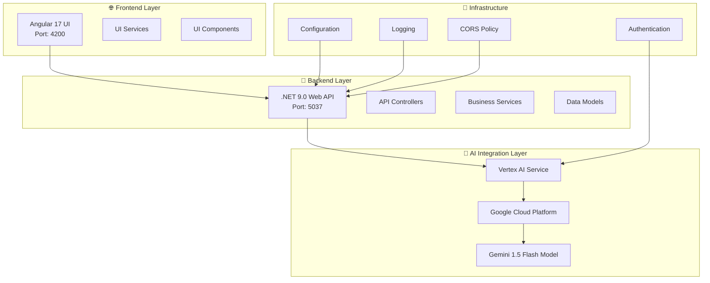
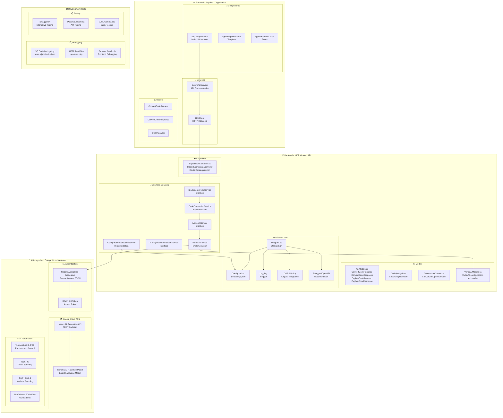
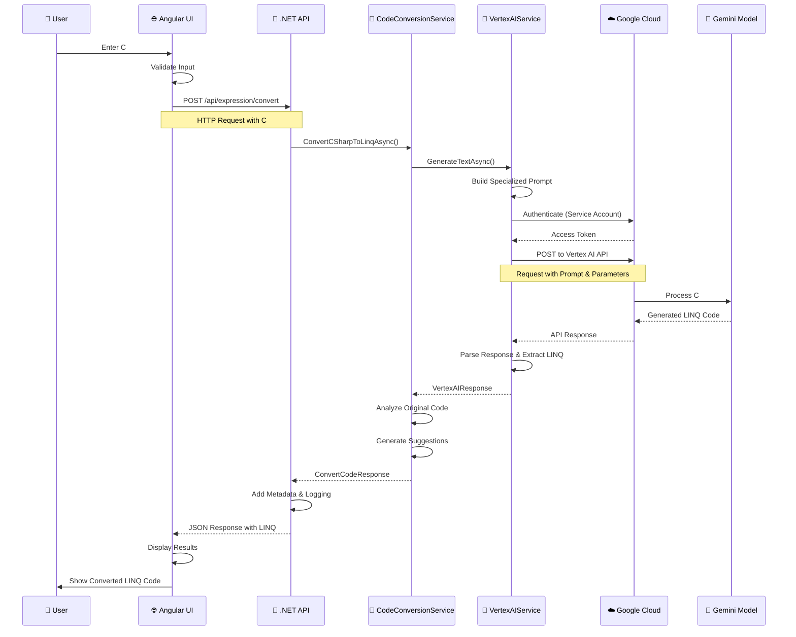
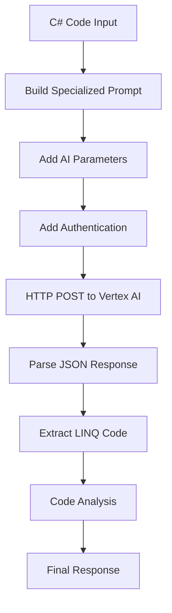
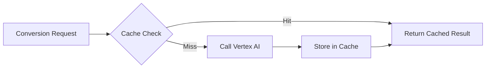
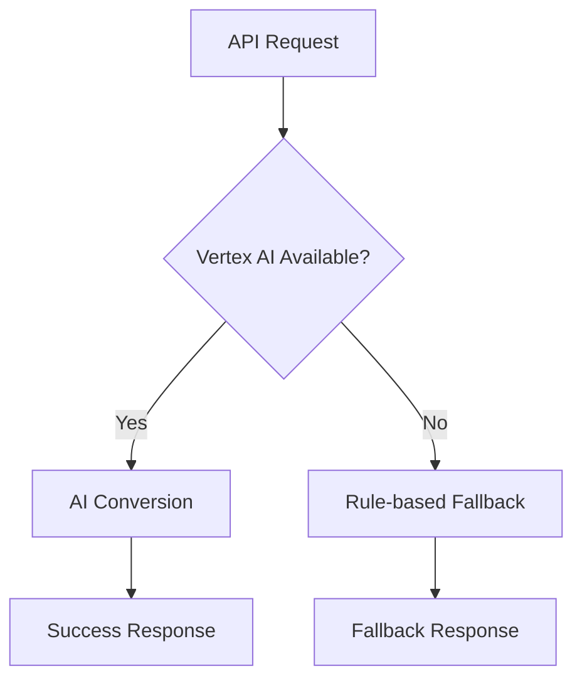
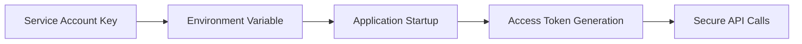

# 🏗️ LINQ Converter AI - Application Architecture

## 🎯 **High-Level System Overview**



## 🏛️ **Detailed Application Architecture**



## 🔄 **Data Flow Architecture**



## 🏗️ **Module Breakdown**

### **🌐 Frontend Modules**

#### **1. Core UI Components**
```typescript
📁 src/app/
├── 📄 app.component.ts          // Main application logic
├── 📄 app.component.html        // UI template with dual-pane layout
├── 📄 app.component.scss        // Responsive styling
└── 📄 app.component.spec.ts     // Unit tests
```

**Key Features:**
- **Dual-pane interface** (C# input | LINQ output)
- **Syntax highlighting** for code blocks
- **Copy-to-clipboard** functionality
- **Loading states** and error handling
- **Conversion options** (performance, comments, explanations)

#### **2. Service Layer**
```typescript
📁 src/app/services/
├── 📄 converter.service.ts          // Main API communication service
└── 📄 converter.service.spec.ts     // Service unit tests
```

**Service Methods:**
- `convertCode()` - Convert C# to LINQ
- `explainCode()` - Get AI explanation
- `getCommonPatterns()` - Retrieve examples
- `checkHealth()` - API connectivity

### **🚀 Backend Modules**

#### **1. API Controllers**
```csharp
📁 Controllers/
└── 📄 ExpressionController.cs       // File name (contains CodeConversionController class)
```

**Controller Details:**
- **File**: `ExpressionController.cs`
- **Class**: `ExpressionController` 
- **Route**: `/api/expression`

**Endpoints:**
- `POST /api/expression/convert` - Main C# to LINQ conversion
- `POST /api/expression/explain` - Code explanation with AI
- `GET /api/expression/health` - Health check endpoint

#### **2. Business Services**
```csharp
📁 Services/
├── 📄 CodeConversionService.cs          // Main business logic
├── 📄 VertexAIService.cs                // AI integration
└── 📄 ConfigurationValidationService.cs // Config validation
```

**Service Responsibilities:**
- **CodeConversionService**: Orchestrates conversion workflow
- **VertexAIService**: Handles Google Cloud AI communication with Agent Framework
- **ConfigurationValidationService**: Validates AI configuration

#### **3. Data Models**
```csharp
📁 Models/
├── 📄 ApiModels.cs              // API request/response contracts
│                                // ConvertCodeRequest, ConvertCodeResponse
│                                // ExplainCodeRequest, ExplainCodeResponse
├── 📄 CodeAnalysis.cs           // Code analysis results model
├── 📄 ConversionOptions.cs      // Conversion configuration options
└── 📄 VertexAIModels.cs         // AI service models and configuration
```

### **🤖 AI Integration Architecture**

#### **1. Authentication Flow**
```mermaid
graph LR
    JSON[Service Account JSON] --> ENV[Environment Variable]
    ENV --> GOOGLE[GoogleCredential.FromFile()]
    GOOGLE --> SCOPE[CreateScoped()]
    SCOPE --> TOKEN[GetAccessTokenForRequestAsync()]
    TOKEN --> API[Vertex AI API Call]
```

#### **2. AI Request Pipeline**


### **🔧 Infrastructure Components**

#### **1. Configuration Management**
```json
📁 Configuration/
├── 📄 appsettings.json           // Production settings
├── 📄 appsettings.Development.json // Development settings
└── 📄 launchSettings.json        // Launch profiles
```

#### **2. Dependency Injection**
```csharp
// Program.cs Service Registration
services.Configure<VertexAIConfiguration>(config);
services.AddHttpClient<IVertexAIService, VertexAIService>();
services.AddScoped<ICodeConversionService, CodeConversionService>();
services.AddScoped<IConfigurationValidationService, ConfigurationValidationService>();
```

## 🔗 **Integration Points**

### **1. Frontend ↔ Backend Communication**
- **Protocol**: HTTP/HTTPS REST API
- **Data Format**: JSON
- **Authentication**: None (development) / JWT (production)
- **CORS**: Configured for `http://localhost:4200`

### **2. Backend ↔ Google Cloud Integration**
- **Protocol**: HTTPS REST API
- **Authentication**: OAuth 2.0 with Service Account
- **Endpoint**: `https://us-central1-aiplatform.googleapis.com/v1/...`
- **Model**: `gemini-1.5-flash-001`

### **3. Development Tools Integration**
- **VS Code**: Full debugging support with launch.json
- **HTTP Testing**: REST Client extension with test files
- **Swagger**: Interactive API documentation
- **Git**: Version control with .gitignore for secrets

## 📊 **Performance & Scalability**

### **1. Caching Strategy**


### **2. Error Handling & Fallbacks**


## 🛡️ **Security Architecture**

### **1. Authentication Chain**


### **2. Data Security**
- **Secrets Management**: Environment variables for credentials
- **API Security**: HTTPS only in production
- **Input Validation**: Sanitize C# code input
- **Output Filtering**: Clean AI responses

This comprehensive architecture ensures a robust, scalable, and maintainable C# to LINQ converter powered by Google's advanced AI capabilities! 🚀